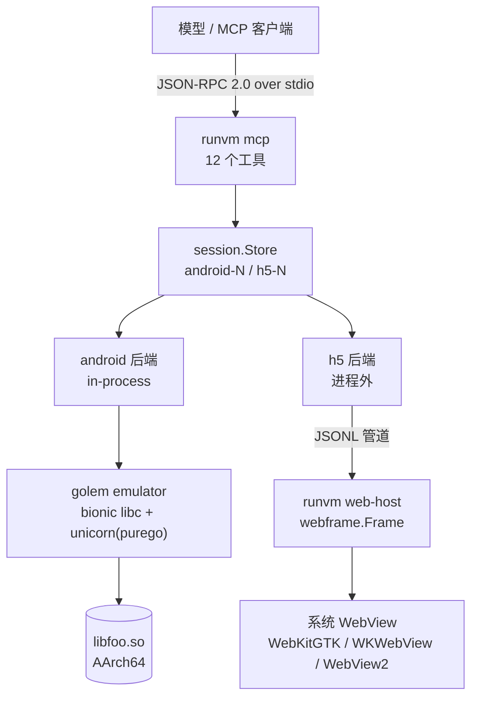

# runvm

把「虚拟测试环境」做成模型能直接调用的工具:一套 MCP 服务器,两个后端。

- **Android**:用 [golem](https://github.com/isesword/golem) 在本机加载一个 AArch64 的 `.so`,跑它的 `init_array` / `JNI_OnLoad`,然后把导出函数直接调用起来——不需要 JVM、不需要真机、不需要 adb。
- **H5**:用 [webframe](https://github.com/tractordev/webframe) 把页面跑在系统自带的 WebKit 里,可以执行任意 JS、点击、断言,拿回真实的 DOM 结果。

模型不再"读代码猜行为":它能开一个环境、调一个符号、跑一段 JS、读出结果。

```
$ echo '{"jsonrpc":"2.0","id":1,"method":"tools/call","params":{"name":"android_call",
  "arguments":{"session":"android-1","symbol":"fib","args":[20]}}}' | runvm
{"jsonrpc":"2.0","id":1,"result":{"content":[{"type":"text","text":"{\n  \"hex\": \"0x1a6d\",\n  \"i32\": 6765,\n  \"symbol\": \"fib\",\n  \"value\": 6765\n}"}]}}
```

## 架构



三层职责分明:

| 层 | 位置 | 职责 |
|---|---|---|
| MCP 传输 | `internal/mcp` | JSON-RPC 2.0、`initialize`/`tools/list`/`tools/call`,零依赖 |
| 工具与会话 | `internal/tools`、`internal/session` | 参数校验、会话 ID、生命周期 |
| 后端 | `internal/android`、`internal/h5` | 真正加载 .so / 真正跑页面 |

## 为什么是这两个后端,以及为什么这样接

**Android 用 golem 而不是 adb/模拟器**:golem 是纯 Go 的 native 库模拟框架,把 bionic(`libc/libm/libdl`)和目标 `.so` 一起映射进一块虚拟地址空间,指令由 unicorn 执行。产物是单个二进制、`CGO_ENABLED=0`,可以在 CI 容器里跑签名/加密这类"必须调 native 才知道结果"的逻辑。runvm 只做会话层:一个会话一个 emulator,串行化调用(golem 的 emulator 不是并发安全的),并发靠多开会话。

**H5 用子进程而不是同进程**:webframe 的 `Frame` 必须建在主 goroutine 上,`Run()` 会一直阻塞它——一个页面独占一个进程。而 MCP 服务器要长期存活并服务多个会话,两者无法共存于一个主线程。所以每个页面是一个 `runvm web-host` 子进程,父子之间走一行一个 JSON 的管道:控制流清晰,页面崩了也不会带走 MCP 服务器。

`web-host` 里补了两件 webframe 库不做、但库的调用方必须自己做的事(它的 CLI 里做了):无 `DISPLAY` 时拉起私有 Xvfb,以及把本地路径转成 `file://` URL。

## 安装

从 [Releases](https://github.com/dolfly/runvm/releases) 下载对应平台(linux / darwin / windows × amd64 / arm64),解压即单个二进制,无 cgo 依赖:

```bash
tar -xzf runvm_*.tar.gz 2>/dev/null || unzip runvm_*.zip
./runvm doctor
```

Alpine/musl **不在**发布矩阵里:purego 无 cgo 只支持 glibc,musl 需要 zig + cgo 的独立工具链,见 [docs/ROADMAP.md](docs/ROADMAP.md)。

## 从源码构建

要求:Go 1.27+;Linux 额外需要 WebKitGTK 和 Xvfb(Android 后端需要 libunicorn)。

```bash
# 1. 编译(用 -tags unicorn 才会编入 CPU 引擎)
make build            # -> bin/runvm

# 2. 自检:会真的启动一个 emulator 和一个 WebView
./bin/runvm doctor
#   ✓ bionic sysroot  /path/to/golem/assets
#   ✓ cpu engine      booted bionic in 42ms
#   ✓ webview         about:blank ready in 812ms

# 3. 接到 MCP 客户端
```

```json
{
  "mcpServers": {
    "runvm": {
      "command": "/abs/path/bin/runvm",
      "args": [],
      "env": {
        "RUNVM_ASSETS": "/path/to/golem/assets",
        "GOLEM_UNICORN": "/usr/lib/libunicorn.so.2"
      }
    }
  }
}
```

Linux 依赖:`apt install libwebkit2gtk-4.1-0 xvfb libgl1-mesa-dri`;Unicorn 在 Debian/Ubuntu 上是 `libunicorn2`,若发行版没有,可以从 Python wheel 里取(`pip install unicorn` 后 `unicorn/lib/libunicorn.so.2`)。

## MCP 工具

| 工具 | 作用 |
|---|---|
| `runvm_status` | 两个后端是否可用、有几个会话(**不启动任何东西**) |
| `android_open` | 加载 `.so`,跑 init,返回 `android-N` |
| `android_symbols` | 列出导出函数(直接读 ELF,不依赖会话能否启动) |
| `android_hook` | 把导出函数替换成"返回常量"的桩,用来摘掉依赖再测周边逻辑 |
| `android_java_stub` | 应答库通过 JNI 发起的 Java 回调(如 `System.currentTimeMillis`),不需要真 Android |
| `android_java_stubs` | 列出当前会话应答了哪些 Java 回调 |
| `android_call` | 调一个导出函数,返回 `value`/`hex`/`i32` |
| `android_close` | 释放 emulator |
| `h5_open` | 在 WebKit 里打开 URL / 本地文件 / `about:blank` |
| `h5_eval` | 在页面里执行 JS,返回结果(自动 await Promise) |
| `h5_console` | 取回缓冲的 console 与页面异常 |
| `h5_close` | 关闭页面宿主进程 |

参数细节见 [docs/mcp.md](docs/mcp.md)。请求是**并发处理**的(不同会话互不阻塞),响应按 `id` 对应,可能乱序返回。`android_call` 的 `args` 支持三种形态,一条调用就能覆盖大多数 native 接口:

```jsonc
{"args": [2, 3]}                    // 整数参数
{"args": ["hello"]}                 // char*,自动拷进 guest 内存
{"args": [{"buffer": 64}, 20]}      // 出参:64 字节缓冲区,调用后读回 hex/ascii
```

`android_open` 还可以开一个**引擎池**(`"pool": 4`):多个 AArch64 引擎共享 `.so` 的只读页,同一会话的调用就能真并行。默认 1,即一次一个调用。

## 环境变量

| 变量 | 作用 |
|---|---|
| `RUNVM_ASSETS` | golem 的 bionic sysroot(`assets/android/sdk23`);不设则用 golem 模块内路径 |
| `RUNVM_ENGINE` | `android_open` 未指定 `engine` 时的默认后端 |
| `GOLEM_UNICORN` | 显式指定 `libunicorn` 路径(golem 读取) |

## 限制,以及它**不是**什么

- **不是安全沙箱**。加载的 `.so` 在你的进程里被模拟执行,页面在真实 WebKit 里运行。只跑你信任的代码。
- **一个页面一个进程**,`h5_open` 的成本约 0.5–1.5 秒;批量测试请复用会话。不同页面之间并行,同一个页面内的 `h5_eval` 串行(保证语句顺序)。
- **没有截图/PDF/网络拦截**。webframe 的 API 不提供,而 glaze 启动 WebView 时不带调试端口,所以"正经接 CDP"也无从下手;三条可行路线在 [docs/ROADMAP.md](docs/ROADMAP.md),现在刻意不做而不是做个假的。
- **macOS / Windows 未实测**。代码路径按 webframe/golem 的支持写好了(macOS 无需 Xvfb,Windows 需要 WebView2),但没有 CI 覆盖。
- **`go.mod` 里有一条 `replace`**。webframe 把 glaze 钉在作者的 fork 上,而 Go 会忽略依赖里的 `replace`,所以本模块必须重复一遍;升级 webframe 时这里要跟着改。

## 开发

```bash
make build     # 带 unicorn 引擎
make test      # 单元测试(不启动 emulator/浏览器)
make vet
make fmt
./bin/runvm doctor
```

代码结构:

```
cmd/runvm/        入口:mcp / doctor / web-host / version
internal/mcp/     JSON-RPC 2.0 与工具注册(零依赖)
internal/tools/   12 个工具的参数校验与调用编排
internal/session/ 会话注册表(泛型)
internal/android/ golem 会话池 + ELF 导出表 + JNI 桩
internal/h5/      webframe 宿主(子进程)与驱动
internal/doctor/  真实探测两个后端
```

## 依赖与致谢

- [golem](https://github.com/isesword/golem)(Apache-2.0):纯 Go 的 native 库模拟框架,runvm 的 Android 后端是它的一层封装。
- [webframe](https://github.com/tractordev/webframe)(MIT):把网页当程序跑,runvm 的 H5 后端。
- [glaze](https://github.com/progrium/glaze)(MIT):webframe 的纯 Go WebView 绑定,靠 purego 在运行时 `dlopen` 系统 WebView。

MIT License。
