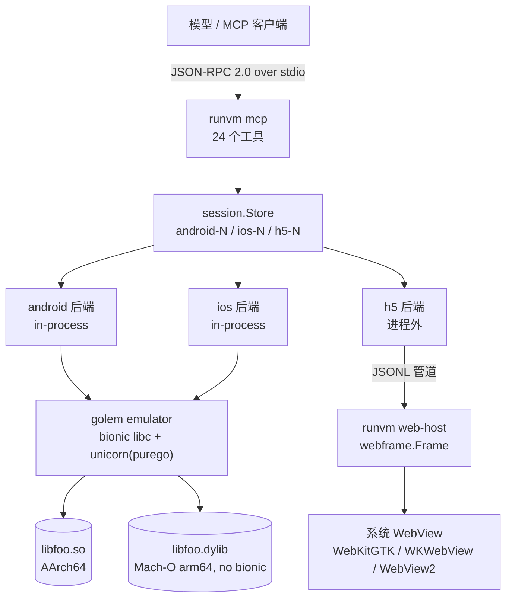

# runvm

**文档站:** <https://dolfly.github.io/runvm/> · 产品介绍、快速开始、工具参考、架构与运维

把「虚拟测试环境」做成模型能直接调用的工具:一套 MCP 服务器,两个后端,和一个按容器格式分流的原生后端。

- **Android**:用 [golem](https://github.com/isesword/golem) 在本机加载一个 AArch64 的 `.so`,跑它的 `init_array` / `JNI_OnLoad`,然后把导出函数直接调用起来——不需要 JVM、不需要真机、不需要 adb。
- **H5**:用 [webframe](https://github.com/tractordev/webframe) 把页面跑在系统自带的 WebKit 里,可以执行任意 JS、点击、断言,拿回真实的 DOM 结果。

模型不再"读代码猜行为":它能开一个环境、调一个符号、跑一段 JS、读出结果。

```
$ echo '{"jsonrpc":"2.0","id":1,"method":"tools/call","params":{"name":"android_call",
  "arguments":{"session":"android-1","symbol":"fib","args":[20]}}}' | runvm
{"jsonrpc":"2.0","id":1,"result":{"content":[{"type":"text","text":"{\n  \"hex\": \"0x1a6d\",\n  \"i32\": 6765,\n  \"symbol\": \"fib\",\n  \"value\": 6765\n}"}]}}
```

## 宣传片

<video src="https://github.com/dolfly/runvm/raw/main/assets/video/runvm-promo.mp4" poster="https://github.com/dolfly/runvm/raw/main/assets/video/runvm-promo-poster.png" controls width="100%"></video>

35 秒产品宣传片：加载 AArch64 `.so` 直接调用 `fib`、`h5_eval` 读回真实 DOM、24 个 MCP 工具一览。视频源文件见 [assets/video/runvm-promo.mp4](assets/video/runvm-promo.mp4)。

## 架构



三层职责分明:

| 层 | 位置 | 职责 |
|---|---|---|
| MCP 传输 | `internal/mcp` | JSON-RPC 2.0、`initialize`/`tools/list`/`tools/call`,零依赖 |
| 工具与会话 | `internal/tools`、`internal/session` | 参数校验、会话 ID、生命周期 |
| 后端 | `internal/android`、`internal/ios`、`internal/h5` | 真正加载 .so / .dylib / 真正跑页面 |

## 为什么是这两个后端,以及为什么这样接

**Android 用 golem 而不是 adb/模拟器**:golem 是纯 Go 的 native 库模拟框架,把 bionic(`libc/libm/libdl`)和目标 `.so` 一起映射进一块虚拟地址空间,指令由 unicorn 执行。产物是单个二进制、`CGO_ENABLED=0`,可以在 CI 容器里跑签名/加密这类"必须调 native 才知道结果"的逻辑。runvm 只做会话层:一个会话一个 emulator,串行化调用(golem 的 emulator 不是并发安全的),并发靠多开会话。

**H5 用子进程而不是同进程**:webframe 的 `Frame` 必须建在主 goroutine 上,`Run()` 会一直阻塞它——一个页面独占一个进程。而 MCP 服务器要长期存活并服务多个会话,两者无法共存于一个主线程。所以每个页面是一个 `runvm web-host` 子进程,父子之间走一行一个 JSON 的管道:控制流清晰,页面崩了也不会带走 MCP 服务器。

**iOS 的 dylib 和 Android 的 `.so` 走同一个模拟器,但不是一个后端**。分流点是**容器格式**而不是扩展名或调用方的意图:golem 自己按魔数选人格(`loader.Sniff`),所以 runvm 只需要在 `android.Open` 之前看一眼——是 Mach-O 就不喂 bionic sysroot、不建 JNI 表,交给 golem 的 Darwin 人格。`android_open` 遇到 Mach-O 也会自动转到这条路上,返回 `ios-N` 会话。诚实的边界是"纯计算":dylib 自己定义的符号能跑;它从 libSystem / Objective-C 导入的东西(`malloc`、`objc_msgSend` …)没有实现,也没有宿主桩可注册(Darwin 的 `ReplaceFns` 还在 golem 的 `internal` 里)。这时分两种情形:直接 `ios_call` 这个符号会明确报「imported but has no implementation」;而 dylib 内部调它,拿到的是 golem 的乐观桩 0(包了 `strlen` 的函数返回 0 而不是长度)。`ios_imports` 读的是 `LC_SYMTAB` 加 bind 流 / chained fixups——也就是 loader 真正用来绑定的那些来源——`ios_open` 的 `system_libs` 则是 `LC_LOAD_DYLIB` 的字面声明。

`web-host` 里补了两件 webframe 库不做、但库的调用方必须自己做的事(它的 CLI 里做了):无 `DISPLAY` 时拉起私有 Xvfb,以及把本地路径转成 `file://` URL。

## 安装

从 [Releases](https://github.com/dolfly/runvm/releases) 下载对应平台(linux / darwin / windows × amd64 / arm64),解压即单个二进制,无 cgo 依赖:

```bash
tar -xzf runvm_*.tar.gz 2>/dev/null || unzip runvm_*.zip
./runvm doctor
```

Alpine/musl **不在**发布矩阵里:purego 无 cgo 只支持 glibc,musl 需要 zig + cgo 的独立工具链,见 [现状与缺口](docs/roadmap.md)。

## Docker

镜像里已经把两个后端要的东西装齐了:WebKitGTK、Xvfb + xauth、xwd(截图用)、Mesa 软件 GL、libunicorn,以及中文字体。**非 root**(uid 10001),`/work` 可写。

```bash
# 自检:会真的启动 WebKit 与 bionic
docker run --rm ghcr.io/dolfly/runvm doctor

# MCP over stdio(客户端按 docker run -i 的方式拉起)
docker run --rm -i ghcr.io/dolfly/runvm

# 远程访问:容器内绑 0.0.0.0,宿主机只暴露回环
docker run --rm -p 127.0.0.1:8765:8765 \
  -e RUNVM_TOKEN=$(openssl rand -hex 16) \
  ghcr.io/dolfly/runvm http -addr 0.0.0.0:8765

# 产物落在挂载目录里(截图 / PDF)
docker run --rm -v "$PWD:/work" ghcr.io/dolfly/runvm ...
```

自己构建:

```bash
docker build -t runvm .
docker run --rm runvm version
```

镜像几百 MB,几乎全是 WebKitGTK 与 CJK 字体——这是"不用自带引擎"的代价的另一面:引擎必须有,只是从宿主机借来了。

> GHCR 的包默认是私有的。第一次发布后到 package 设置里把可见性改成 public,别人才能免登录拉取。

## 从源码构建

要求:Go 1.27+;Linux 额外需要 WebKitGTK 和 Xvfb(Android 后端需要 libunicorn)。

```bash
# 1. 编译(用 -tags unicorn 才会编入 CPU 引擎)
make build            # -> bin/runvm

# 2. 自检:会真的启动一个 emulator 和一个 WebView
make doctor
#   ✓ bionic sysroot  /path/to/golem/assets
#   ✓ cpu engine      booted bionic in 42ms
#   ✓ webview         about:blank ready in 812ms

# 3. 接到 MCP 客户端
```

```json
{
  "mcpServers": {
    "runvm": {
      "command": "/abs/path/bin/runvm",
      "args": [],
      "env": {
        "RUNVM_ASSETS": "/path/to/golem/assets",
        "GOLEM_UNICORN": "/usr/lib/libunicorn.so.2"
      }
    }
  }
}
```

Linux 依赖:`apt install libwebkit2gtk-4.1-0 xvfb libgl1-mesa-dri`;Unicorn 在 Debian/Ubuntu 上是 `libunicorn2`,若发行版没有,可以从 Python wheel 里取(`pip install unicorn` 后 `unicorn/lib/libunicorn.so.2`)。

## MCP 工具

| 工具 | 作用 |
|---|---|
| `runvm_status` | 各后端是否可用、有几个会话、逐会话 `target`/`last_used`/存活状态,以及 `reclaimed` 自动回收历史和 `persistence` 落盘台账(**不启动任何东西**) |
| `runvm_upload` | 把本机文件上传进可写资源空间 `runvm://files/<路径>`,返回 URI / 字节数 / sha256 |
| `runvm_write` | 把文本或 base64 二进制内容写/覆盖到一个可写资源 |
| `runvm_close_all` | 一次关闭指定后端或全部会话,批量释放 `RUNVM_MAX_SESSIONS` 配额 |
| `android_open` | 加载 `.so`,跑 init,返回 `android-N` |
| `android_symbols` | 列出导出函数(直接读 ELF,不依赖会话能否启动) |
| `android_hook` | 把导出函数替换成"返回常量"的桩,用来摘掉依赖再测周边逻辑 |
| `android_java_stub` | 应答库通过 JNI 发起的 Java 回调(如 `System.currentTimeMillis`),不需要真 Android |
| `android_java_stubs` | 列出当前会话应答了哪些 Java 回调 |
| `android_call` | 调一个导出函数,返回 `value`/`hex`/`i32` |
| `android_close` | 释放 emulator |
| `ios_open` | 加载 Mach-O arm64 dylib,返回 `ios-N`(无 JNI、无 bionic) |
| `ios_symbols` | 列出导出与导入符号(读磁盘上的 Mach-O,但仍要一个 ios 会话 id 来定位文件) |
| `ios_imports` | 列出 dylib 需要的外部符号与依赖库——这些没有实现 |
| `ios_call` | 调一个导出函数,返回 `value`/`hex`/`i32` |
| `ios_close` | 释放 ios 会话 |
| `h5_open` | 在 WebKit 里打开 URL / 本地文件 / `about:blank`;传 `profile` + `ephemeral:false` 可把 cookie/localStorage 落到数据目录,重启后按同名 profile 重开仍是登录态 |
| `h5_eval` | 在页面里执行 JS,返回结果(自动 await Promise) |
| `h5_wait_for` | 轮询直到表达式为真或选择器命中,返回当时的取值 |
| `h5_console` | 取回缓冲的 console 与页面异常 |
| `h5_screenshot` | 把页面截成 PNG 返回(Linux,需 `visible: true`) |
| `h5_close` | 关闭页面宿主进程 |

参数细节见 [工具参考](docs/tools.md)。请求是**并发处理**的(不同会话互不阻塞),响应按 `id` 对应,可能乱序返回。`android_call` 的 `args` 支持三种形态,一条调用就能覆盖大多数 native 接口:

```jsonc
{"args": [2, 3]}                    // 整数参数
{"args": ["hello"]}                 // char*,自动拷进 guest 内存
{"args": [{"buffer": 64}, 20]}      // 出参:64 字节缓冲区,调用后读回 hex/ascii
```

`ios_call` 的 `args` 规则与 `android_call` 相同,符号名不带前导下划线(Mach-O 的 `_add` 在 golem 里是 `add`)。

`android_open` 还可以开一个**引擎池**(`"pool": 4`):多个 AArch64 引擎共享 `.so` 的只读页,同一会话的调用就能真并行。默认 1,即一次一个调用。

## 进度、资源、提示词

**进度**:请求带 `_meta.progressToken` 就会收到 `notifications/progress`。stdio 直接交织在输出里;HTTP 会把该次 POST 升级成 SSE 流,先推进度再推结果。没带 token 的客户端行为完全不变。

```json
{"jsonrpc":"2.0","id":1,"method":"tools/call",
 "params":{"name":"h5_open","arguments":{"target":"…"},"_meta":{"progressToken":"t1"}}}
→ {"method":"notifications/progress","params":{"progressToken":"t1","progress":0.4,"total":1,
   "message":"h5_open: host started, waiting for the page"}}
```

**资源**(只读,按 URI 取):

| URI | 内容 |
|---|---|
| `runvm://status` | 后端、限制、活跃会话(JSON) |
| `runvm://tools` | 全部工具与 input schema(JSON) |
| `runvm://files/<路径>` | 可写资源(文本走 text,二进制走 blob),上传/写入后才出现 |
| `runvm://screenshot/<session>` | 该会话最近一次截图(PNG blob),截过之后才出现 |

**提示词**(带参数的模板,客户端 `prompts/get` 取):`smoke-test-page`(url / expectation)——加载、断言、截图、收 console、关闭;`inspect-native-lib`(so / symbol)——加载 .so、列导出、调一个函数。

## 会话治理

长时间跑的服务最怕"模型忘了关"。默认就开空闲回收,加上死会话自动出栈和批量释放:

| 变量 | 默认 | 作用 |
|---|---|---|
| `RUNVM_MAX_SESSIONS` | 8 | android + ios + h5 会话总数上限,超了报错并点名该关哪个 |
| `RUNVM_IDLE_TIMEOUT` | `30m` | 超过这么久没被使用的会话自动关闭,如 `30m`;`0` 表示关闭 |
| `RUNVM_DATA_DIR` | `/work/runvm`(容器外 `<用户配置目录>/runvm`) | 会话台账 + 浏览器 profile 根目录(0700,不存在自动建) |
| `RUNVM_H5_PERSIST` | 空(关) | `ephemeral:false` 且未给 `profile` 时的默认 profile 名(`1` 表示 `default`) |

- `runvm_status` 逐会话报 h5 的 `target` / `last_used` / 存活状态(`alive`/`dead`),android 仍是明细、ios 仍是 ID 列表;`reclaimed` 记录被服务端自动关掉的会话(哪几个、为什么、什么时候)。
- **h5 页面宿主进程死了会自己出栈**:页面 `exit()`、崩溃或被杀时,会话自动移除并释放配额,不需要手动 `h5_close`。android / ios 是进程内模拟器,没有独立宿主进程,不适用死会话出栈。
- **所有使用会话的入口都更新 `last_used`**(`h5_console` / `h5_screenshot` / `h5_pdf` / `webbrain`,以及 android / ios 读路径),正在用的会话不会被空闲回收误杀。
- **批量释放**用 `runvm_close_all`(可只关 `android` / `ios` / `h5`,不传则全关)。

**运行态持久化**:`RUNVM_DATA_DIR` 下的 `sessions.json`(0600)跟随活跃会话,每次开/关重写(临时文件 + rename);损坏时坏文件改名 `.bad-<ts>` 保留并在 `runvm_status.persistence.ledger_error` 报出,服务照常起。`h5_open` 传 `profile` + `ephemeral:false` 时,cookie/localStorage 落在 `profiles/<名字>/`(0700);重启后同名 profile 重开会复用台账里的 id(`restored: true`),不传 profile 则连 `ephemeral:false` 也只是内存态(要默认开设 `RUNVM_H5_PERSIST`)。启动不自动重开页面,`persistence.sessions` 里 `restored`(已恢复可寻址)与 `stale`(只剩记录,带 `reason`/`reopen`)分开报。**优雅重启(`SIGTERM`/`docker restart`)不清台账**:关机只关子进程,最后一次活跃快照留在盘上,重启后这些会话报 `stale` 且 id 不复用。Linux 走 `XDG_DATA_HOME`(实测重启后 cookie 在),Windows 走 `APPDATA`,macOS 的 WKWebView 只能改 `HOME`(**未在真机验证**);android/ios 模拟器状态从不落盘。

异步 UI 用 `h5_wait_for` 而不是 `sleep`:

```json
{"session":"h5-1","selector":"[data-ready]","timeout_ms":5000}
→ {"matched":true,"value":{},"waited_ms":386}
```

## 远程访问(HTTP)

stdio 需要客户端能拉起进程;拿不到进程的场景(网页版客户端、别的机器、容器外)用 Streamable HTTP:

```bash
# 绑定非回环地址时必须给 token,否则拒绝启动
RUNVM_TOKEN=$(openssl rand -hex 16) ./bin/runvm http -addr 0.0.0.0:8765
# runvm: MCP over HTTP on http://0.0.0.0:8765/mcp (auth: bearer token)
```

```json
{"mcpServers":{"runvm":{
  "type":"http",
  "url":"https://your-host/mcp",
  "headers":{"Authorization":"Bearer ${RUNVM_TOKEN}"}}}}
```

端点与语义:

| 路径 | 行为 |
|---|---|
| `POST /mcp` | 单条或批量 JSON-RPC;通知返回 `202` 空体 |
| `GET /mcp` | `405`——本服务不推送服务端发起的消息,长连接会白等 |
| `DELETE /mcp` | `200`;会话由 `h5_close` / `android_close` 关,不靠这个 |
| `GET /healthz` | `ok` |

`initialize` 会返回 `Mcp-Session-Id`,本服务不强制回传。**不给 token 就只监听回环**:一个没有鉴权的端口等于让网络里的人在你的 native 模拟器里跑代码,所以 `-addr 0.0.0.0` + 无 token 会被直接拒绝。

### 控制台(SPA)

`runvm http` 同时在 `/` 下提供一套内嵌的单页控制台。前端是 Vite 构建链(`web/`),构建产物提交进 `internal/console/static/dist/` 并由 `go:embed` 打进单个二进制——**运行时不需要 Node、不请求任何外网资源**(零 CDN、零在线字体/图标);`make build` / `go build` / Dockerfile 在没装 Node 的环境里照常编译。

```bash
# 未设置 RUNVM_CONSOLE_PASSWORD 时,启动会生成随机密码并打到 stderr,没有内置默认密码
RUNVM_CONSOLE_USER=admin RUNVM_CONSOLE_PASSWORD=$(openssl rand -hex 16) ./bin/runvm http
# runvm: MCP over HTTP on http://127.0.0.1:8765/mcp (auth: off)
# runvm: console on http://127.0.0.1:8765/ (login: admin)
```

控制台的**任何数据接口未登录一律 `401`**;登录成功下发 `HttpOnly` + `SameSite` 会话 cookie,登出使其失效。控制台登录与 MCP 的 Bearer token 相互独立,控制台不是绕过 MCP 鉴权的入口。未登录访问任意路径(含 `/resources`、`/resources/files`、`/debug` 等深链)都会渲染登录页,登录后回到原路径(`?next=`)。

三段顶层导航,资源管理下带四个二级页:

| 页 | 内容 |
|---|---|
| 系统总览 `/` | 后端可用性、限额、活跃会话列表,每 3 秒自动刷新 |
| 资源管理-检索 `/resources` | 跨类型关键词检索(工具 / 截图 / 文件),结果分组,点击跳到对应子页并选中 |
| 资源管理-工具 `/resources/tools` | `runvm://tools` 的 24 个工具 + input schema,可检索、可看参数表与 schema |
| 资源管理-截图 `/resources/screenshots` | `runvm://screenshot/<session>` 的 PNG,列表 + 预览 + 下载 |
| 资源管理-文件 `/resources/files` | `runvm://files/` 的内置文件浏览器(目录树 + 文件列表 + 按格式打开) |
| MCP 调试 `/debug` | 调 runvm 自己的 MCP server,但**只读**(见下) |

**文件浏览器按格式打开**:图片(`png/jpg/jpeg/gif/webp/bmp/svg`)预览;`json` 树视图 + 编辑(保存前 `JSON.parse` 校验,非法 JSON 报错并阻止保存);`md` 预览 + 编辑;`txt`/文本类直接编辑;其它二进制显示大小 / MIME / sha256 / 修改时间并下载。编辑保存走 `PUT /api/resources/file`(复用 `Store.Write`),保存后 MCP `resources/read` 立即读到新内容;上传并入文件页(拖拽或选择文件),与 `runvm_upload` 同一套校验与上限。只读资源(`runvm://tools` / `runvm://status` / 截图 / pdf)在文件浏览器里不给编辑入口,视觉上与可写资源区分。

**中英文(i18n)**:所有界面文案走 token(`web/locales/zh-CN.json` / `en-US.json`,构建期 inline),顶栏右侧「中文 / EN」分段切换,切换不刷新整页并记住偏好(localStorage + cookie);工具名 / 参数名 / schema / URI / 时间戳 / 后端原始错误一律不翻译。字体用系统字体栈(`Sarasa Mono SC` 等 CJK 等宽字体仅作为回退,**不随二进制打包**)。

调试页对齐 Inspector：顶部连接条显示真实连接信息（server 名称 / 版本 / 协商后的协议版本 / capabilities 列表，来自 `initialize` 的真实返回）；资源与提示词分组显示描述文字、点选即预填 `resources/read` / `prompts/get` 参数；`tools/call` 与 `resources/read` 结果按内容分类渲染（图片看图、JSON 树视图、PDF/二进制给大小与下载），报文与历史可回看。进程内直调无 SSE 进度流，界面明确标注。

调试页的 `tools/call` 走**白名单**(`debugCallableTools`):只有确实只读的工具(`runvm_status` / `android_symbols` / `android_java_stubs` / `ios_symbols` / `ios_imports` / `h5_console`)可调;写工具(`runvm_write`/`runvm_upload`)与所有状态变更工具(含 `*_open`/`*_close`/`runvm_close_all`/`android_hook`/`android_java_stub`/`h5_eval`/`h5_pdf`/`h5_screenshot`/`webbrain`)在左栏显示为「不可调用」、不给调用入口。调试页连的是进程内 runvm 自己,不给写 runvm 状态的入口。结果区带 Inspector 的 4 条 schema 可移植性检查(`boolean-schema`/`type-union`/`untyped-schema`/`remote-ref`)。

## 环境变量

| 变量 | 作用 |
|---|---|
| `RUNVM_ASSETS` | golem 的 bionic sysroot(`assets/android/sdk23`);不设则用 golem 模块内路径 |
| `RUNVM_ENGINE` | `android_open` 未指定 `engine` 时的默认后端 |
| `GOLEM_UNICORN` | 显式指定 `libunicorn` 路径(golem 读取) |
| `RUNVM_RESOURCES_DIR` | 可写资源根目录(默认工作目录下 `runvm-resources`,不存在自动建,0700) |
| `RUNVM_RESOURCES_MAX_SIZE` | 单个上传/写入上限,如 `64MiB`(默认 64MiB) |
| `RUNVM_DATA_DIR` | 会话台账 + 浏览器 profile 根目录(默认 `/work/runvm`,容器外 `<用户配置目录>/runvm`,0700) |
| `RUNVM_H5_PERSIST` | `ephemeral:false` 且未给 `profile` 时的默认 profile(`1`/`true` 用 `default`,也可写名字;默认关) |
| `RUNVM_CONSOLE_USER` | 控制台登录用户名(默认 `admin`) |
| `RUNVM_CONSOLE_PASSWORD` | 控制台登录密码;未设置时启动生成随机密码打到 stderr,**无内置默认密码** |

## 限制,以及它**不是**什么

- **不是安全沙箱**。加载的 `.so` 在你的进程里被模拟执行,页面在真实 WebKit 里运行。只跑你信任的代码。
- **一个页面一个进程**,`h5_open` 的成本约 0.5–1.5 秒;批量测试请复用会话。不同页面之间并行,同一个页面内的 `h5_eval` 串行(保证语句顺序)。
- **回收是尽力而为的**:空闲回收按 `last_used` 计时,页面宿主进程退出会即时出栈;会话身份与登录态默认不落盘(要持久化就显式传 `profile`,见 [运行与运维](docs/operations.md))。
- **截图:三个平台都可用**(Linux Xvfb+xwd / Windows PrintWindow / macOS WKWebView snapshot)。
  - Linux:页面用 `visible: true` 画进本进程自己起的 Xvfb(屏幕=视口),`xwd` 抓根窗口,Go 里解 XWD 转 PNG——拿到的一定是那个页面,不会误抓桌面。
  - Windows:`PrintWindow` + `PW_RENDERFULLCONTENT` 抓**页面宿主子进程**的窗口。这里踩过一个坑:窗口在子进程里,而抓取在父进程里运行,按自己的 pid 枚举永远找不到——现在把宿主的 pid 传下去。CI 实测 `640x400, 19 distinct colours`。
  - macOS:走 WKWebView 自己的 `takeSnapshotWithConfiguration:completionHandler:`——页面自己栅格化,不需要窗口、不需要 display。由两个 fork 承载:`dolfly/glaze`(加 `Snapshotter` 旁路接口)和 `dolfly/webframe-fork`(`Frame.Snapshot()`),都按 tag 钉住。CI 在 macos-latest 上实测 `640x400, 2 distinct colours`。
  - 没有网络拦截。
- **PDF:macOS 是矢量的**。`h5_pdf` 先让页面自己打印(WKWebView `createPDFWithConfiguration:`,由 `dolfly/glaze` v0.4.0 的 `PrintPDF()` 与 `dolfly/webframe-fork` v0.3.0 的 `Frame.PrintPDF()` 承载):文本还是文本、滚动内容的整页都在、而且不需要 `visible`。Linux/Windows 仍是"截图 + 嵌入"的栅格 PDF。返回值里的 `vector` 字段说明这一次拿到的是哪一种,工具描述也不再自称矢量。
- **平台覆盖到"能启动",没到"全功能"**。CI 在 macOS(arm64)与 Windows(amd64)上跑 build + 单测 + `doctor`,`doctor` 会真的启动 WKWebView / WebView2 并加载一个页面(macOS 3.6s、Windows 8.4s 就绪),bionic 也都在 20ms 内启动。**截图三平台都有,PDF 的矢量版本只有 macOS**:Linux/Windows 的栅格 PDF 依赖抓屏,所以要 `visible: true`。
- **iOS 只到"纯计算"**。Mach-O arm64 的 dylib 能加载、能调自己定义的导出函数(`add`、`via_fptr_table`、直接 `svc #0x80` 的 Darwin 系统调用都实测通过),但 libSystem / Foundation / Objective-C 那一层没有:外部模块注册不了 Darwin 的宿主桩。直接调这类导入符号会明确报「imported but has no implementation」,而库内部调它会拿到 golem 的乐观 0——包了 `strlen` 的函数返回 0,而不是长度。等 golem 把 Darwin 的 `ReplaceFns` 开出门面(`ios_hook` 的第二阶段)之前,这个边界不会变。工具描述里写明了这一点,因为"函数返回 0"看起来很像"函数就是返回 0"。
- **iOS 的 dylib 必须用非 lazy bind 链接**。默认 `clang -arch arm64 -dynamiclib` 出的是 lazy bind,golem 直接拒:`carries lazy/weak bind streams (unsupported)`,因为它不模拟 dyld 的 stub binder。加 `-Wl,-bind_at_load`(非 lazy bind)或 `-Wl,-fixup_chains`(chained fixups)即可,`ios_open` 的报错里也带这句提示。
- **`go.mod` 里有一条 `replace`**。webframe 把 glaze 钉在作者的 fork 上,而 Go 会忽略依赖里的 `replace`,所以本模块必须重复一遍;升级 webframe 时这里要跟着改。

## 开发

```bash
make build     # 带 unicorn 引擎
make test      # 单元测试(不启动 emulator/浏览器)
make vet
make fmt
make doctor      # 自检要单独构建：golem 靠二进制里的模块路径找 bionic 资产，
                 # 而 make build 用的 -trimpath 会把那段路径抹掉
```

代码结构:

```
cmd/runvm/        入口:mcp / doctor / web-host / version
internal/mcp/     JSON-RPC 2.0 与工具注册(零依赖)
internal/tools/   24 个工具的参数校验与调用编排
internal/session/ 会话注册表(泛型,带 add/remove 钩子)
internal/persist/ 会话台账 + 浏览器 profile(数据目录、原子写、平台重定向)
internal/resources/ 可写资源存储(runvm://files/ 背后的磁盘根)
internal/console/  HTTP 控制台(SPA + 登录鉴权 + 只读 MCP 调试页)
internal/android/ golem 会话池 + ELF 导出表 + JNI 桩
internal/ios/     golem 会话池 + Mach-O 导出/导入表(无 JNI)
internal/h5/      webframe 宿主(子进程)与驱动
internal/doctor/  真实探测各后端
web/              控制台前端(Vite + 原版 TS,产出内嵌进 internal/console/static/dist/)
```

## 依赖与致谢

- [golem](https://github.com/isesword/golem)(Apache-2.0):纯 Go 的 native 库模拟框架,runvm 的 Android 后端是它的一层封装。
- [webframe](https://github.com/tractordev/webframe)(MIT):把网页当程序跑,runvm 的 H5 后端。
- [glaze](https://github.com/progrium/glaze)(MIT):webframe 的纯 Go WebView 绑定,靠 purego 在运行时 `dlopen` 系统 WebView。

MIT License。
